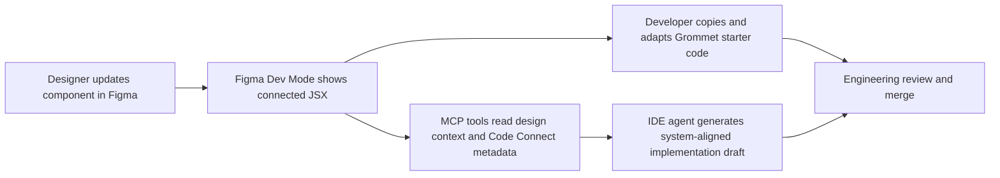

# HPE Design System — Figma Code Connect

> **Innovation Sprint:** Bridging the gap between Figma designs and production-ready Grommet code.

## What Is This?

This package contains **Figma Code Connect** mappings for HPE Design System components. Code Connect is a Figma feature that bridges the design-to-development handoff gap — when a designer selects a component in Figma Dev Mode, instead of seeing raw CSS or Figma auto-generated pseudo-code, they see **real, production-ready Grommet JSX** that a developer can copy directly into a project.

### Before Code Connect

A developer inspecting a Button in Figma Dev Mode would see:

```
/* Auto Layout */
display: flex;
flex-direction: row;
align-items: center;
padding: 8px 16px;
background: #01A982;
```

### After Code Connect

The same developer now sees:

```jsx
import { Button } from 'grommet';

<Button label="Submit" primary size="medium" />;
```

---

## Why It Matters

| Problem                                               | Code Connect Solution                       |
| ----------------------------------------------------- | ------------------------------------------- |
| Developers translate Figma to code manually           | Real Grommet code shown in Dev Mode         |
| Designers don't know which component name to use      | Component linked directly to source         |
| Prop names differ between design and code             | Figma properties mapped to real React props |
| Wrong libraries imported (inline styles, wrong icons) | Correct HPE imports shown automatically     |

This directly supports the HPE Design System goal of a consistent, efficient design-to-code workflow: less handoff friction, fewer implementation mismatches, and clearer ownership of the design-to-code contract.

What changes in day-to-day workflow:

- Designers continue working in Figma as usual, but the component shown in Dev Mode now includes DS-approved code examples instead of generic CSS snippets.
- Developers inspecting that same component can copy a realistic Grommet starting point, including expected imports and mapped prop names.
- Design and engineering review the same component behavior vocabulary (for example, variant names and prop intent), reducing translation gaps during implementation.

How this is consumed with Figma only:

- In Dev Mode, a consumer selects a component and sees connected JSX examples authored in this repository.
- The examples reflect mapped design properties, so the output is tied to the component state being inspected.
- This improves handoff quality even when no MCP tooling is involved.

How this is consumed with Figma MCP + IDE agents:

- MCP tools can read the same design context and Code Connect metadata when generating code in the IDE.
- Agents get both visual/design inputs and production-aware mapping intent (component, props, imports), which reduces generic or off-system output.
- Teams can keep design-to-code behavior aligned across manual Dev Mode usage and AI-assisted implementation workflows.

### Quick Workflow View



This creates two complementary paths: direct Dev Mode handoff for human implementation, and MCP-assisted generation for faster first drafts using the same mapping source of truth.

---

## Components Available in the Repository

### `controls`

- [Anchor](src/controls/Anchor.figma.ts)
- [Button](src/controls/Button.figma.ts)
- [Menu](src/controls/Menu.figma.ts)
- [Tab](src/controls/Tab.figma.ts)
- [Tabs](src/controls/Tabs.figma.ts)
- [Tag](src/controls/Tag.figma.ts)

### `inputs`

- [CheckBox](src/inputs/CheckBox.figma.ts)
- [CheckBoxGroup](src/inputs/CheckBoxGroup.figma.ts)
- [DateInput](src/inputs/DateInput.figma.ts)
- [NumberInput](src/inputs/NumberInput.figma.ts)
- [RadioButton](src/inputs/RadioButton.figma.ts)
- [RadioButtonGroup](src/inputs/RadioButtonGroup.figma.ts)
- [Select](src/inputs/Select.figma.ts)
- [SelectMultiple](src/inputs/SelectMultiple.figma.ts)
- [TextInput](src/inputs/TextInput.figma.ts)
- [TimeInput](src/inputs/TimeInput.figma.ts)

### `layouts`

- [Card](src/layouts/Card.figma.ts)

### `visualisations`

- [Avatar](src/visualisations/Avatar.figma.ts)
- [Notification](src/visualisations/Notification.figma.ts)
- [Skeleton](src/visualisations/Skeleton.figma.ts)
- [Spinner](src/visualisations/Spinner.figma.ts)
- [Tip](src/visualisations/Tip.figma.ts)

Notification maps Status to `status`, Kind to `global`/`toast`, and the Title,
onClose, and Actions toggles to optional `title`, `onClose`, and `actions` props.
The message and enabled title/action text are representative content, not
parent-exposed Figma text properties.

---

## Project Setup

### Prerequisites

- Node.js 20+
- pnpm
- A Figma account with access to the HPE Design System Components file

### Token Setup

1. In Figma → **Settings → Security → Personal access tokens**
2. Create a token with these scopes:
   - `file_content:read` (under Files)
   - `file_code_connect:write` (under Development)
3. Copy the token into `knowledge/code-connect/.env`:

```
FIGMA_ACCESS_TOKEN=figd_your_token_here
```

> `.env` is gitignored — never commit your token.

### Install & Publish

Publishing Code Connect v2 pushes each `.figma.ts` template in this package to
Figma and attaches it to the component identified by its leading `// url=` directive.

After a successful publish:

- Figma Dev Mode shows repository-authored JSX snippets from each template's `example`.
- Templates read variants, booleans, text, and nested instances through
  `figma.selectedInstance` and render real Grommet props with `figma.code`.
- Designers and developers get a shared design-to-code contract directly in Dev Mode instead of manually translating visual specs.

What publish does not do:

- It does not generate production source files in this repository.
- It does not modify Figma visual design content; it updates Code Connect metadata used by Dev Mode.
- It does not replace engineering review; it publishes mapping intent.

```bash
# Install dependencies
pnpm install

# Publish all mappings to Figma
pnpm --filter @hpe-design/code-connect figma:sync
```

Equivalent from `knowledge/code-connect/`:

```bash
pnpm run figma:sync
```

### Troubleshooting sync

- `No config file found ... proceeding with default options` is informational,
  but this package requires `figma.config.json` to discover its `.figma.ts`
  templates. Run from the package directory or use the root-scoped sync command.
- `ERR_PNPM_RECURSIVE_RUN_FIRST_FAIL` reports that the underlying command failed.
  Look above it for the original error.
- If `minimatch` throws `brace_expansion_1.expand is not a function`, check the
  root dependency overrides. The `brace-expansion` 1.1.18 override must apply only
  to version-1 consumers (`brace-expansion@<2`), not to newer major versions with
  different APIs. Run `pnpm install` after correcting the override, then retry sync.
- `403 Token expired` means the Figma token must be replaced in the local `.env`.
  Generate a new token with the scopes above; do not paste it into chat or commit it.
- `Framework-specific parsers are no longer supported` means a legacy
  `figma.connect` mapping is being passed to v2. Migrate it to a `.figma.ts` template.

---

## Adding a New Component

### Step 1 — Scaffold from Figma

```bash
cd knowledge/code-connect
dotenv -e .env -- figma connect create "<figma-component-url>"
```

Inspect the generated template against the real Figma property inventory and
Grommet API. Keep the v2 parserless format (`import figma from 'figma'` plus a
default-exported `figma.code` example), not a legacy `figma.connect` file.
Place `<ComponentName>.figma.ts` in the matching existing family folder under `src/`.
Notification, for example, belongs in `src/visualisations/`.

### Step 2 — Map the properties

Open the generated file and replace placeholder mappings with real ones. Use the [Authoring Patterns](#authoring-patterns) section below as a reference.

### Step 3 — Validate and publish

```bash
pnpm --filter @hpe-design/code-connect typecheck
pnpm --filter @hpe-design/code-connect exec figma connect parse --exit-on-unreadable-files
pnpm --filter @hpe-design/code-connect figma:sync
```

Typechecking and parsing are local checks. Publishing and previews require a valid
Figma token. To inspect representative variant output before publishing:

```bash
cd knowledge/code-connect
pnpm exec dotenv -e .env -- figma connect preview src/controls/Button.figma.ts --unique
```

Fix validation errors (property name typos, wrong node type, etc.) then re-run.

### Migrating legacy mappings

The 21 existing mappings in this package were converted using Code Connect v2's official
`figma connect migrate` command, preserving component-family folders and variant
branches. For any remaining legacy mappings:

```bash
pnpm --filter @hpe-design/code-connect exec figma connect migrate --delete --exit-on-unreadable-files
```

Review generated source links, imports, structured prop values, and variant
branches. Keep legacy `__props` metadata only if parent templates consume it.

### Step 4 — Verify in Figma Dev Mode

Open the Figma file, select the component, open Dev Mode, and confirm the code panel shows your JSX.

---

## How It Works — The Data Flow

```
Designer selects component in Figma Dev Mode
              ↓
  Figma reads component property values
  (e.g. Kind="primary", Size="large")
              ↓
    Template property accessors translate
    Figma properties → React prop values
              ↓
    figma.code interpolates those values
              ↓
    JSX rendered and shown to developer
```

The template runtime is supplied by Figma, not imported from the application:

```ts
// url=https://www.figma.com/design/HDckqS2MWhINfC8EIQPMV1/HPE-Design-System-Components-V2?node-id=2133-694
// source=https://github.com/grommet/grommet/blob/master/src/js/components/Button/Button.js
// component=Button
import figma from 'figma';

const label = figma.selectedInstance.getString('Label');
const badge = figma.selectedInstance.getBoolean('show Badge', {
  true: true,
  false: undefined,
});

export default {
  id: 'Button',
  imports: ["import { Button } from 'grommet';"],
  example: figma.code`<Button${figma.helpers.react.renderProp('label', label)}${figma.helpers.react.renderProp('badge', badge)} />`,
  metadata: { nestable: true },
};
```

Use `getString` for text, `getBoolean` for booleans, `getEnum` for variants, and
`getInstanceSwap` for swappable instances. Match Figma property names and options
exactly, and map all known enum values. `renderProp` handles React quoting,
booleans, structured values, and omission of `undefined`.

---

## Authoring Patterns

### 1. Structural variants

Branch in TypeScript when Figma states require different snippet structures,
then default-export the selected template. See [Avatar](src/visualisations/Avatar.figma.ts)
and [Menu](src/controls/Menu.figma.ts). Unlike the v1 JSX parser, v2 templates
support ordinary TypeScript conditionals.

### 2. Enum for boolean-sourced non-boolean outputs

When a single Figma enum/variant drives **two separate React boolean props**, map them independently:

```ts
const primary = figma.selectedInstance.getEnum('Kind', { primary: true });
const secondary = figma.selectedInstance.getEnum('Kind', { secondary: true });
```

When `Kind = "primary"` → `primary={true}`, `secondary={undefined}`. Used in: **Button**

### 3. Icons must use `@hpe-design/icons-grommet`

Always import icons from `@hpe-design/icons-grommet`, not `grommet-icons`:

```js
// ✓ Correct
import { Home, More, Add } from '@hpe-design/icons-grommet';

// ✗ Wrong
import { CircleInformation } from 'grommet-icons';
```

### 4. Grouped Menu items use nested arrays

Grommet `Menu` groups items by nesting arrays — each sub-array becomes a separator group:

```js
items={[
  [{ label: 'Action 1' }, { label: 'Action 2' }],  // group 1
  [{ label: 'Delete' }],                             // group 2 (separated)
]}
```

Figma's "show 2nd Group" / "show 5th Group" toggles are prototype design-time conveniences — they don't map to React props.

### 5. Resolve properties on the correct instance

`figma.selectedInstance` accesses the connected component's properties.
For example, `show Icon` belongs to Tab, not Tabs. Read configurable children
through their own templates rather than assuming child properties exist on the parent.

### 6. Preserve structured snippet results

`executeTemplate().example` returns structured sections, not a string. Interpolate
these sections in `figma.code`; never concatenate them or call `.join()`.
Check `type === 'INSTANCE'` before executing a child template.

### 7. Reading a prop is not the same as rendering it

Every mapped value must be included in the exported snippet. Use
`figma.helpers.react.renderProp` for optional React props and
`figma.helpers.react.object`, `.array`, and `.function` for code-valued props.

---

## Limitations

| Limitation                                | Impact                                          | Workaround                                         |
| ----------------------------------------- | ----------------------------------------------- | -------------------------------------------------- |
| Structured snippets are not strings       | Concatenation can produce invalid output        | Interpolate sections with `figma.code`             |
| Local parse does not execute Figma states | Bundling alone cannot verify all snippets       | Preview representative variants with a valid token |
| Prototype-only Figma props                | Figma group toggles have no React equivalent    | Dropped from mapping, static representative shown  |
| Property access scoped to instance        | Child properties are not parent properties      | Resolve the child's own template                   |
| Figma Dev Mode shows duplicate imports    | Visual issue when parent + child both connected | Figma display behaviour, not fixable               |

---

## File Structure

```
knowledge/code-connect/
├── src/
│   ├── controls/
│   │   ├── Anchor.figma.ts
│   │   ├── Button.figma.ts
│   │   ├── Menu.figma.ts
│   │   ├── Tab.figma.ts
│   │   ├── Tabs.figma.ts
│   │   └── Tag.figma.ts
│   ├── inputs/
│   │   ├── CheckBox.figma.ts
│   │   ├── CheckBoxGroup.figma.ts
│   │   ├── DateInput.figma.ts
│   │   ├── NumberInput.figma.ts
│   │   ├── RadioButton.figma.ts
│   │   ├── RadioButtonGroup.figma.ts
│   │   ├── Select.figma.ts
│   │   ├── SelectMultiple.figma.ts
│   │   ├── TextInput.figma.ts
│   │   └── TimeInput.figma.ts
│   ├── layouts/
│   │   └── Card.figma.ts
│   └── visualisations/
│       ├── Avatar.figma.ts
│       ├── Notification.figma.ts
│       ├── Skeleton.figma.ts
│       ├── Spinner.figma.ts
│       └── Tip.figma.ts
├── .env                   # FIGMA_ACCESS_TOKEN (gitignored)
├── figma.config.json      # .figma.ts discovery and React label
├── package.json           # typecheck and figma:sync scripts
├── tsconfig.json          # Figma template runtime types
└── README.md
```

---

## Lessons Learned

### What was harder than expected

- **Token scopes aren't obvious** — need both `file_content:read` AND `file_code_connect:write`; missing either gives a cryptic 403
- **Figma node type matters** — connect to a `COMPONENT` or `COMPONENT_SET` node, not a Frame; always copy the link from the component itself not the surrounding frame
- **Major CLI upgrades can change file formats** — Code Connect v2 requires parserless templates; use the official migration command rather than publishing v1 JSX files
- **Parent and child components need separate files** — `Tabs` and `Tab` are two different Figma nodes with separate property sets
- **Grommet and Figma attributes are not always 1:1** — Figma uses `Icon = left/right` for position; Grommet uses `icon={<Add />}` plus a separate `reverse` prop. One Figma property mapped to two React props
- **Reading a prop is not the same as rendering it** — a property accessor must feed the exported snippet or the value disappears from the output
- **Figma prototype toggles ≠ React props** — design-time visibility toggles (e.g. "show 2nd Group") have no code equivalent; mapping them creates noise

### What we'd do differently

- Always start with `figma connect create` — never hand-author property names
- Audit property accessors against the exported snippet — every mapped value must be rendered
- Add `figma.config.json` from day one to avoid CLI path detection issues
- Store the token in a shared secrets manager, not per-developer `.env` files
- Prefer the package sync command directly from the repo root so publish behavior stays consistent across contributors

---

## To Be Done — Scaling to All Components

Getting to full coverage across the HPE Design System is the long-term goal. Here's a realistic path for how to get there.

### Full Component Inventory

The HPE Design System has ~55 components with documented Figma counterparts. Based on the current docs examples, here's a prioritised breakdown:

**Tier 1 — High frequency, simple props (easiest wins)**

| Component          | Key Props to Map                                     |
| ------------------ | ---------------------------------------------------- |
| `Anchor`           | `label`, `href`, `icon`, `reverse`                   |
| `Avatar`           | `name`, `src`, `size`, `background`                  |
| `CheckBox`         | `checked`, `disabled`, `label`, `toggle`             |
| `RadioButtonGroup` | `options`, `disabled`                                |
| `Select`           | `options`, `placeholder`, `disabled`, `multiple`     |
| `SelectMultiple`   | `options`, `placeholder`, `limit`                    |
| `Skeleton`         | `height`, `width`, `round`                           |
| `Spinner`          | `size`, `message`                                    |
| `TextInput`        | `placeholder`, `disabled`, `icon`, `reverse`, `size` |
| `Tip`              | `content`, `plain`                                   |

**Tier 2 — Medium complexity, high designer-dev friction**

| Component           | Key Props to Map                                 |
| ------------------- | ------------------------------------------------ |
| `Accordion`         | Static multi-item example                        |
| `DataTable`         | Static column + data example                     |
| `DropButton`        | `label`, `dropContent`, `open`                   |
| `Footer` / `Header` | Layout composition examples                      |
| `NameValueList`     | Static composition example                       |
| `Notification`      | `status`, `title`, `message`, `toast`, `onClose` |
| `PageHeader`        | `title`, `subtitle`, `parent`, `actions`         |
| `Pagination`        | `numberItems`, `step`, `page`                    |
| `Search`            | `placeholder`, `onChange`                        |
| `TimeInput`         | `format`, `value`, `disabled`, `readOnly`        |
| `ToggleGroup`       | `options`, `value`                               |

**Tier 3 — Complex / data-driven (need static representative examples)**

| Component             | Notes                                    |
| --------------------- | ---------------------------------------- |
| `Calendar`            | `date`, `disabled`                       |
| `Carousel`            | Static slides example                    |
| `Chart` / `DataChart` | Static data props only                   |
| `Data` + `DataTable`  | Needs representative static dataset      |
| `Diagram`             | Static nodes and connections             |
| `Drop`                | `target`, `align`, `stretch`             |
| `Layer`               | Modal/panel pattern, `modal`, `position` |
| `Meter`               | `values`, `type`, `max`                  |

### Recommended Approach to Scale

**1. One component per sprint**
Use `figma connect create` to scaffold, refine the mapping, and publish in the same session. Aim for 2-3 components per innovation sprint.

**2. Keep template discovery explicit**
The package-root `figma.config.json` includes all family folders:

```json
{
  "codeConnect": {
    "include": ["src/**/*.figma.ts"],
    "label": "React"
  }
}
```

**3. Add a CI publish step**
Wire `pnpm run figma:sync` into a GitHub Actions workflow so Code Connect stays in sync automatically:

```yaml
# .github/workflows/figma-code-connect.yml (future)
on:
  push:
    branches: [main]
    paths:
      - 'knowledge/code-connect/src/**'
jobs:
  publish:
    runs-on: ubuntu-latest
    steps:
      - uses: actions/checkout@v4
      - run: pnpm install
      - run: pnpm --filter @hpe-design/code-connect run figma:sync
        env:
          FIGMA_ACCESS_TOKEN: ${{ secrets.FIGMA_ACCESS_TOKEN }}
```

### Coverage Tracker

#### `controls`

| Component | Status       |
| --------- | ------------ |
| `Anchor`  | ✅ Connected |
| `Button`  | ✅ Connected |
| `Menu`    | ✅ Connected |
| `Tab`     | ✅ Connected |
| `Tabs`    | ✅ Connected |
| `Tag`     | ✅ Connected |

#### `inputs`

| Component          | Status       |
| ------------------ | ------------ |
| `CheckBox`         | ✅ Connected |
| `CheckBoxGroup`    | ✅ Connected |
| `DateInput`        | ✅ Connected |
| `NumberInput`      | ✅ Connected |
| `RadioButton`      | ✅ Connected |
| `RadioButtonGroup` | ✅ Connected |
| `Select`           | ✅ Connected |
| `SelectMultiple`   | ✅ Connected |
| `TextInput`        | ✅ Connected |
| `TimeInput`        | ✅ Connected |

#### `layouts`

| Component | Status       |
| --------- | ------------ |
| `Card`    | ✅ Connected |

#### `visualisations`

| Component      | Status       |
| -------------- | ------------ |
| `Avatar`       | ✅ Connected |
| `Notification` | ✅ Connected |
| `Skeleton`     | ✅ Connected |
| `Spinner`      | ✅ Connected |
| `Tip`          | ✅ Connected |

#### Backlog / Not started

| Component       | Status         |
| --------------- | -------------- |
| `Accordion`     | 🔲 Not started |
| `Calendar`      | 🔲 Not started |
| `Carousel`      | 🔲 Not started |
| `Chart`         | 🔲 Not started |
| `Data`          | 🔲 Not started |
| `DataTable`     | 🔲 Not started |
| `Diagram`       | 🔲 Not started |
| `Drop`          | 🔲 Not started |
| `DropButton`    | 🔲 Not started |
| `Footer`        | 🔲 Not started |
| `Header`        | 🔲 Not started |
| `Layer`         | 🔲 Not started |
| `Meter`         | 🔲 Not started |
| `NameValueList` | 🔲 Not started |
| `PageHeader`    | 🔲 Not started |
| `Pagination`    | 🔲 Not started |
| `Search`        | 🔲 Not started |
| `ToggleGroup`   | 🔲 Not started |

---

## References

- [Figma Code Connect docs](https://github.com/figma/code-connect)
- [HPE Design System Components (Figma)](https://www.figma.com/design/HDckqS2MWhINfC8EIQPMV1/HPE-Design-System-Components-V2)
- [Grommet component docs](https://v2.grommet.io/components)
- [HPE Design System site](https://design.hpe.com)
